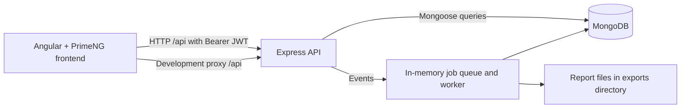

# Taskora | Task Management Workspace

Taskora is a task management workspace with an Angular web client and an Express/MongoDB API. It supports account sign-in, role-scoped dashboards, task assignment and tracking, activity and reminders, and asynchronous report exports.

> **Project scope:** This repository contains both a frontend and backend. Public registration creates regular users only; an administrator account must be provisioned through a trusted backend workflow.

## Contents

- [Project overview](#project-overview)
- [Technology stack](#technology-stack)
- [Architecture at a glance](#architecture-at-a-glance)
- [Quick start](#quick-start)
- [Key features](#key-features)
- [Documentation](#documentation)
- [Project structure](#project-structure)
- [Limitations](#limitations)

## Project overview

Taskora brings task ownership, assignments, due dates, priorities, and status tracking into one workspace. It helps individuals and teams see their authorized work, coordinate task changes, monitor deadlines, and export task data.

## Technology stack

| Area | Technologies | Purpose |
|---|---|---|
| Frontend | Angular 19, TypeScript, Angular Router, RxJS | Standalone, lazy-loaded browser application with typed API contracts |
| UI | PrimeNG 19, Aura theme, PrimeIcons, CSS | UI controls, icons, responsive workspace layout and theme styling |
| Backend | Node.js, Express 4, CommonJS | HTTP API, request handling and application lifecycle |
| Data | MongoDB, Mongoose 8 | Persistent users, tasks, activities and notifications |
| Authentication | JWT (HS256), bcryptjs | Bearer-token authentication and password hashing |
| Async work | Node.js EventEmitter, timers and in-memory queue | Activity/notification jobs, retries, reminders and report generation |
| Tests | Node.js built-in test runner | Backend unit and HTTP API tests |

## Architecture at a glance



The Angular development server runs on port `4200` and proxies `/api` to the backend on port `5000`. Backend authorization remains the source of truth; frontend guards only control navigation and display.

## Quick start

### Prerequisites

- Node.js 20+ (Node.js 22 is recommended for the Angular setup)
- npm
- A running MongoDB instance

### 1. Configure and run the backend

In PowerShell, open a terminal in `task_management_backend`:

```powershell
npm.cmd install
```

Create `task_management_backend\.env` locally (there is no checked-in `.env.example`):

```dotenv
MONGO_URI=mongodb://127.0.0.1:27017/task_management
JWT_SECRET=<generate-a-random-secret-at-least-32-characters-long>
JWT_EXPIRES_IN=1d
PORT=5000
REMINDER_INTERVAL_MINUTES=60
# Optional: EXPORT_DIR=C:\path\to\private\exports
```

Use your own randomly generated secret; do not commit `.env` or use the placeholder above as a secret. Start MongoDB, then run:

```powershell
npm.cmd run dev
```

### 2. Run the frontend

In a second PowerShell terminal, open `task_management_frontend`:

```powershell
npm.cmd install
npm.cmd start
```

Open [http://localhost:4200/login](http://localhost:4200/login). The Angular dev proxy forwards `/api` requests to `http://localhost:5000`; update [`task_management_frontend/proxy.conf.json`](task_management_frontend/proxy.conf.json) if the backend port changes.

### 3. Run backend tests

In `task_management_backend`:

```powershell
npm.cmd test
npm.cmd run test:integration
```

For the Angular production build:

```powershell
npm.cmd run build
```

## Key features

- Registration and sign-in; JWT session restoration and role-aware navigation.
- User and admin dashboards backed by server-scoped task metrics.
- Task creation, editing, assignment, status changes, filtering, sorting and pagination.
- Activity feed and notification inbox, including due-soon and overdue reminders.
- In-memory background jobs with bounded concurrency and exponential retries.
- Asynchronous JSON, CSV and summary report generation, job polling and requester-only downloads.

## Documentation

- [Architecture and onboarding guide](docs/ARCHITECTURE.md) — modules, workflows, data model, permissions, setup, testing, milestones and troubleshooting.
- [API reference](docs/API.md) — endpoints, authorization, request parameters and example responses.
- [Backend specification](task_management_backend/SPECIFICATION.md) — detailed backend behavior and implementation notes.
- [Backend update notes](task_management_backend/UPDATE_NOTES.md) — additive backend changes.
- [Frontend README](task_management_frontend/README.md) — frontend feature-to-API mapping and local validation checklist.

## Project structure

```text
TaskManagement/
├── docs/                         # Project architecture and API reference
├── task_management_backend/      # Express API, MongoDB models and tests
└── task_management_frontend/     # Angular standalone application
```

See the [complete source tree and module guide](docs/ARCHITECTURE.md#folder-structure).

## Limitations

The queue and job status are in memory and reset when the backend restarts. CORS is permissive, and frontend JWTs are stored in `sessionStorage`. This is a learning baseline rather than a production-hardened deployment; recommendations are documented in the [architecture guide](docs/ARCHITECTURE.md#future-enhancements).
