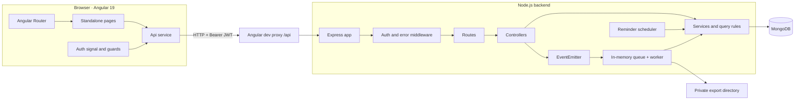
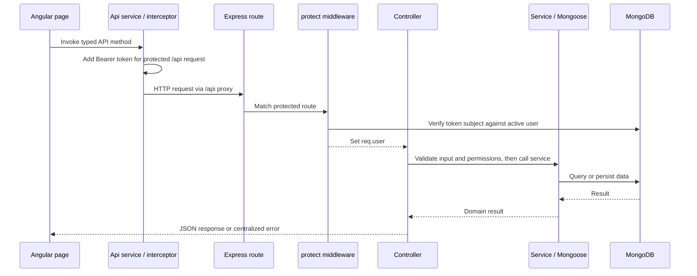
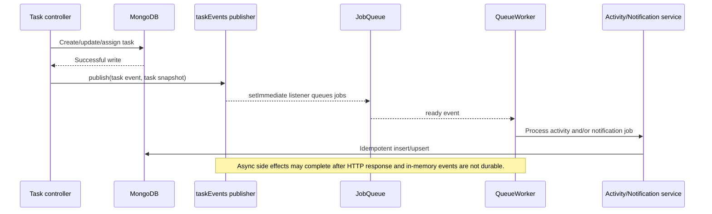
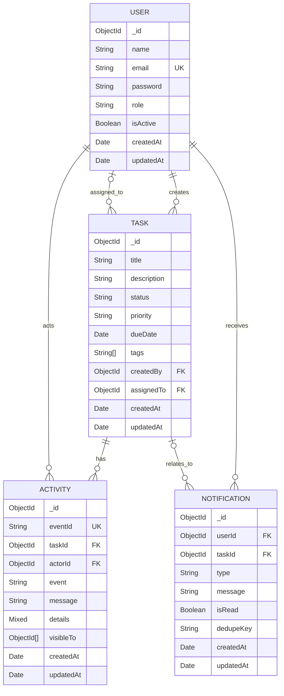

# Taskora Architecture and Onboarding Guide

This guide documents the current source workspace: the Angular frontend, Express backend, MongoDB data model, API integration, setup, and known gaps. It describes implemented behavior, not a proposed design.

## Contents

- [System architecture](#system-architecture)
- [Folder structure](#folder-structure)
- [Frontend architecture](#frontend-architecture)
- [Backend architecture](#backend-architecture)
- [End-to-end workflows](#end-to-end-workflows)
- [Module guide](#module-guide)
- [Database design](#database-design)
- [Roles and permissions](#roles-and-permissions)
- [Configuration and local setup](#configuration-and-local-setup)
- [Error handling and security](#error-handling-and-security)
- [Testing](#testing)
- [Feature status](#feature-status)
- [Future enhancements](#future-enhancements)
- [Troubleshooting](#troubleshooting)

## System architecture

The UI is an Angular 19 single-page application. It sends HTTP requests to the Express API using `/api` paths. During local development, Angular CLI's proxy forwards them to `http://localhost:5000`. The backend validates requests and the JWT, applies task visibility and ownership rules, and uses Mongoose to read or write MongoDB.

Task changes publish events after successful database writes. Event listeners enqueue work in a process-local FIFO queue. A worker handles activity, notification, and report jobs. Reports are written under the configured export directory. The reminder scheduler independently checks task due dates and writes deduplicated notifications.



### Request path



## Folder structure

Generated files, dependency directories, and local secret files are intentionally omitted.

```text
TaskManagement/
├── README.md
├── docs/
│   ├── API.md
│   └── ARCHITECTURE.md
├── task_management_backend/
│   ├── README.md
│   ├── UPDATE_NOTES.md
│   ├── SPECIFICATION.md
│   ├── package.json
│   ├── package-lock.json
│   ├── server.js
│   ├── .gitignore
│   ├── src/
│   │   ├── app.js
│   │   ├── config/db.js
│   │   ├── controllers/
│   │   │   ├── activityController.js
│   │   │   ├── authController.js
│   │   │   ├── dashboardController.js
│   │   │   ├── notificationController.js
│   │   │   ├── reportController.js
│   │   │   ├── taskController.js
│   │   │   └── userController.js
│   │   ├── errors/AppError.js
│   │   ├── events/
│   │   │   ├── registerListeners.js
│   │   │   └── taskEvents.js
│   │   ├── examples/
│   │   │   ├── classCallbacks.js
│   │   │   └── promiseConcurrency.js
│   │   ├── jobs/reminderScheduler.js
│   │   ├── middleware/
│   │   │   ├── auth.js
│   │   │   └── errorHandler.js
│   │   ├── models/
│   │   │   ├── Activity.js
│   │   │   ├── Notification.js
│   │   │   ├── Task.js
│   │   │   └── User.js
│   │   ├── queues/jobQueue.js
│   │   ├── routes/
│   │   │   ├── activityRoutes.js
│   │   │   ├── authRoutes.js
│   │   │   ├── dashboardRoutes.js
│   │   │   ├── jobRoutes.js
│   │   │   ├── notificationRoutes.js
│   │   │   ├── reportRoutes.js
│   │   │   ├── taskRoutes.js
│   │   │   └── userRoutes.js
│   │   ├── services/
│   │   │   ├── activityService.js
│   │   │   ├── dashboardService.js
│   │   │   ├── exportService.js
│   │   │   ├── jobService.js
│   │   │   ├── notificationService.js
│   │   │   └── taskService.js
│   │   ├── utils/
│   │   │   ├── asyncHandler.js
│   │   │   ├── csvUtils.js
│   │   │   └── retry.js
│   │   └── workers/
│   │       ├── jobHandlers.js
│   │       └── queueWorker.js
│   └── tests/
│       ├── api.test.js
│       └── core.test.js
└── task_management_frontend/
    ├── README.md
    ├── angular.json
    ├── package.json
    ├── package-lock.json
    ├── proxy.conf.json
    ├── tsconfig.json
    ├── tsconfig.app.json
    └── src/
        ├── index.html
        ├── main.ts
        ├── styles.css
        └── app/
            ├── routes.ts
            ├── core/
            │   ├── api.ts
            │   └── models.ts
            └── pages/
                ├── auth.ts
                ├── dashboard.ts
                ├── feeds.ts
                ├── reports.ts
                ├── shell.ts
                └── tasks.ts
```

### Important root and configuration files

- [`README.md`](../README.md): project overview and quick start.
- [`task_management_backend/server.js`](../task_management_backend/server.js): validates startup configuration, connects to MongoDB, initializes indexes, starts listeners, worker, scheduler and HTTP server.
- [`task_management_backend/src/app.js`](../task_management_backend/src/app.js): configures CORS, JSON parsing, API mount points, 404 handling and error middleware.
- [`task_management_backend/package.json`](../task_management_backend/package.json): backend scripts and direct dependencies.
- [`task_management_frontend/angular.json`](../task_management_frontend/angular.json): Angular CLI build and serve targets.
- [`task_management_frontend/proxy.conf.json`](../task_management_frontend/proxy.conf.json): local `/api` proxy target.
- [`task_management_frontend/src/main.ts`](../task_management_frontend/src/main.ts): standalone Angular bootstrap, router, HTTP interceptor, animations and PrimeNG Aura preset.

## Frontend architecture

The client uses standalone Angular components and lazy-loaded route components. There is no separate `components/`, `services/`, or `guards/` folder; corresponding functionality lives in the `pages/` and `core/` files listed below. No separate state-management library is present.

### Routes and layout

[`routes.ts`](../task_management_frontend/src/app/routes.ts) defines:

- Public `/login` and `/register`.
- Protected shell routes for dashboards, tasks, notifications, activity and reports.
- Admin-only `/admin/dashboard` and `/admin/team`.
- Lazy-loaded page components via `loadComponent`.
- A default redirect to the role-specific dashboard and a wildcard redirect to login.

[`shell.ts`](../task_management_frontend/src/app/pages/shell.ts) provides the sidebar, top bar, role indicator, theme toggle, responsive navigation and sign-out.

### Pages and their responsibilities

| Page/module | File | Responsibility |
|---|---|---|
| Authentication | [`auth.ts`](../task_management_frontend/src/app/pages/auth.ts) | Register and sign in; show request validation/API errors |
| Dashboard | [`dashboard.ts`](../task_management_frontend/src/app/pages/dashboard.ts) | Render server-returned task counts, priority distribution, completion visualization and recent activity; same page for admin and user scopes |
| Tasks | [`tasks.ts`](../task_management_frontend/src/app/pages/tasks.ts) | Task listing, filters, sorting, pagination, details dialog and create/edit/status/assign/delete operations |
| Notifications | [`feeds.ts`](../task_management_frontend/src/app/pages/feeds.ts) | Notification list and mark-read actions; polls every 15 seconds while mounted |
| Activity | [`feeds.ts`](../task_management_frontend/src/app/pages/feeds.ts) | Display latest server-authorized activity |
| Team directory | [`feeds.ts`](../task_management_frontend/src/app/pages/feeds.ts) | Admin-only, read-only active user directory for assignment |
| Reports and jobs | [`reports.ts`](../task_management_frontend/src/app/pages/reports.ts) | Start report jobs, poll job metadata every five seconds, and download the requester's completed export |

### API client, state, guards and models

- [`api.ts`](../task_management_frontend/src/app/core/api.ts) defines `Api`, a typed wrapper around Angular `HttpClient`, with methods for auth, dashboard, tasks, users, activity, notifications, jobs and reports.
- `Auth` in the same file holds the signed-in user in an Angular signal, stores the token as `taskora_token` in `sessionStorage`, restores the current user through `/auth/me`, and handles logout.
- The functional `authInterceptor` adds a Bearer token to protected `/api` calls and logs out on HTTP 401.
- The functional `signedIn` and `roleGuard` route guards restore/check the session and role. They are user-experience controls, not substitutes for backend authorization.
- [`models.ts`](../task_management_frontend/src/app/core/models.ts) contains TypeScript interfaces and enum-like string unions matching backend payloads.
- No shared component library, separate frontend validator module, or dedicated state store exists in this source tree.

### UI and styles

- PrimeNG 19 components are used for buttons, forms, cards, tables, dialogs, tags, paginator, progress bars, selects and password input.
- PrimeNG Aura is configured in `main.ts`; PrimeIcons are imported by `styles.css`.
- `styles.css` defines the responsive layout, light/dark CSS variables, workspace pages and simple CSS-generated completion visualization.
- No charting library or frontend test script is configured in `package.json`.

### Frontend API flow

Page components call `Api` methods and keep view-specific data and loading/error state locally. `HttpClient` serializes JSON and returns observables; `Api` exposes promises using `firstValueFrom`. The interceptor attaches the session token, the development proxy forwards the call, and the page renders the returned typed response. Backend errors are converted to display text by `errorText`.

## Backend architecture

### Layer responsibilities

| Layer | Location | Responsibility |
|---|---|---|
| Routes | [`src/routes/`](../task_management_backend/src/routes/) | Map HTTP verbs/paths to handlers and apply `protect` to private endpoints |
| Controllers | [`src/controllers/`](../task_management_backend/src/controllers/) | Validate request shape, enforce resource-level permissions, invoke services, publish events and form responses |
| Services | [`src/services/`](../task_management_backend/src/services/) | Task filters/queries, dashboard aggregation, activity and notification logic, job visibility and export generation |
| Models | [`src/models/`](../task_management_backend/src/models/) | Define Mongoose schemas, validators, references, timestamps and indexes |
| Middleware | [`src/middleware/`](../task_management_backend/src/middleware/) | Verify Bearer JWT/reload active user; normalize errors into API responses |
| Utilities | [`src/utils/`](../task_management_backend/src/utils/) | Promise error forwarding, retry policy and CSV cell escaping |
| Configuration | [`src/config/db.js`](../task_management_backend/src/config/db.js) | Connect Mongoose to `MONGO_URI` |
| Events | [`src/events/`](../task_management_backend/src/events/) | Schedule task event listeners after successful task writes |
| Background processing | [`src/queues/`](../task_management_backend/src/queues/) and [`src/workers/`](../task_management_backend/src/workers/) | Maintain FIFO in-memory jobs and run handlers with bounded concurrency/retries |
| Scheduler | [`src/jobs/reminderScheduler.js`](../task_management_backend/src/jobs/reminderScheduler.js) | Periodically scan incomplete tasks for due-tomorrow and overdue reminders |
| Tests | [`tests/`](../task_management_backend/tests/) | Unit-test retry/queue/CSV/error behavior and HTTP routes |

There is no standalone validators directory. `validateTask` and `validateListParams` in `taskService.js`, plus controller checks, implement validation.

### Selected backend module flows

- **Authentication:** `authRoutes` → `authController` → `User` model; passwords are hashed with bcrypt on registration and compared on login. `auth.js` verifies tokens and reloads an active user per protected request.
- **Task operation:** `taskRoutes` → `taskController` → validation and authorization → `taskService` → `Task`/`User` model. Successful task writes publish a task event.
- **Dashboard:** `dashboardRoutes` → `dashboardController` → `dashboardService`; parallel MongoDB counts/aggregations are scoped to the current user unless admin.
- **Activity/notification:** task event listener → `JobQueue` → `QueueWorker` → handler → activity/notification service → Mongoose model. Event IDs and notification dedupe keys make retried writes idempotent.
- **Report:** report route/controller validates filters and enqueues a report job. `exportService` reloads the requester, applies the same visibility/filter query builder, streams rows or aggregates a summary, writes a temporary file and renames it when complete.
- **Error:** rejected async handler → `asyncHandler` → Express `next(err)` → `errorHandler`; known custom, Mongoose, JSON parser and database errors receive mapped status/code/message.

### Task event sequence



## End-to-end workflows

### Registration, login and protected navigation

1. The auth page submits credentials through `Api`.
2. The backend validates and creates a user (registration always assigns `user`) or compares the supplied password with the stored bcrypt hash.
3. The backend returns a public user and JWT.
4. `Auth.accept` stores the token in `sessionStorage`, updates the user signal, and navigates to `/dashboard` or `/admin/dashboard`.
5. On reload, `signedIn` calls `/api/auth/me`. The backend verifies the token and confirms the account is active.
6. Route guards check roles for admin pages. Protected backend endpoints independently enforce authorization.

### Task creation and assignment

1. The task page submits only the permitted task fields.
2. The backend validates title, description, enums, dates and tags; `createdBy` comes from the authenticated user rather than request input.
3. Task ownership and assignment determine subsequent visibility.
4. The owner/admin may assign an active user; assignee receives an asynchronous assignment notification unless they were the actor.
5. Task event jobs add activity and relevant notification records.

### Search and list flow

The UI submits status, priority, search, tags, due-date bounds, sort, order, page and limit to `GET /api/tasks`. Backend validation builds a MongoDB match with mandatory visibility scope, escapes the search string, treats the `toDate` as inclusive, and computes results/page metadata. Matching any supplied tag qualifies.

### Report generation

```mermaid
flowchart TD
    A[Reports page submits filters + format] --> B[POST /api/reports/{json,csv,summary}]
    B --> C[Validate filter keys and values]
    C --> D[Create in-memory report job]
    D --> E[Return HTTP 202 and job metadata]
    D --> F[Worker processes report]
    F --> G[Reload active requester and apply task visibility]
    G --> H{Requested format}
    H -->|JSON or CSV| I[Stream MongoDB cursor to temporary file]
    H -->|Summary| J[Aggregate status counts]
    I --> K[Rename temporary file]
    J --> K
    K --> L[Mark job completed]
    L --> M[Frontend polls GET /api/jobs]
    M --> N[Requester downloads via report job ID]
```

### Reminders

The scheduler runs an initial check after startup and then repeats every `REMINDER_INTERVAL_MINUTES`. It finds incomplete tasks due before the UTC day after tomorrow, emits due-tomorrow or overdue notifications to the creator and assignee, and uses a unique dedupe key per recipient/task/type/due date.

## Module guide

| Module | Key files | Responsibility, behavior and dependencies |
|---|---|---|
| Auth | `src/controllers/authController.js`, `src/routes/authRoutes.js`, `src/middleware/auth.js`, `src/models/User.js`; frontend `core/api.ts`, `pages/auth.ts` | Registration/login, public user payload, JWT issuance/verification, active-account check and protected session restoration |
| Users/team | `src/controllers/userController.js`, `src/routes/userRoutes.js`; frontend `pages/feeds.ts` | Returns active users as a name/ID directory for assignment; UI is read-only and team route is admin-only |
| Tasks | `src/controllers/taskController.js`, `src/services/taskService.js`, `src/routes/taskRoutes.js`, `src/models/Task.js`; frontend `pages/tasks.ts` | Ownership/assignee checks; field validation; list filtering, MongoDB aggregation pagination, sorting and CRUD/status/assignment |
| Dashboard | `src/controllers/dashboardController.js`, `src/services/dashboardService.js`, `src/routes/dashboardRoutes.js`; frontend `pages/dashboard.ts` | Counts total/completed/pending/in-progress/overdue tasks, priority distribution, recent activity and unread notifications |
| Activity | `src/controllers/activityController.js`, `src/services/activityService.js`, `src/models/Activity.js`; frontend `pages/feeds.ts` | Writes deduplicated event records asynchronously; returns latest 50 records visible to the caller or all for admin |
| Notifications | `src/controllers/notificationController.js`, `src/services/notificationService.js`, `src/models/Notification.js`; frontend `pages/feeds.ts` | Creates event/reminder notices, deduplicates, lists current user's notices, marks one or all read |
| Jobs | `src/queues/jobQueue.js`, `src/workers/queueWorker.js`, `src/workers/jobHandlers.js`, `src/services/jobService.js`, `src/routes/jobRoutes.js`; frontend `pages/reports.ts` | Tracks in-memory work status/errors/results, retries eligible failures, exposes owner/admin metadata |
| Reports | `src/controllers/reportController.js`, `src/services/exportService.js`, `src/routes/reportRoutes.js`, `src/utils/csvUtils.js`; frontend `pages/reports.ts` | Validates and schedules JSON/CSV/summary exports, streams files, protects CSV formula values and restricts downloads to requester |
| Errors/utilities | `src/errors/AppError.js`, `src/middleware/errorHandler.js`, `src/utils/asyncHandler.js`, `src/utils/retry.js` | Typed HTTP errors, Express async propagation, centralized mapping and exponential retry |
| Learning examples | `src/examples/classCallbacks.js`, `src/examples/promiseConcurrency.js` | Standalone Node demonstrations of callback `this` binding and Promise concurrency combinators |

Input/output details and response examples are in the [API reference](API.md).

## Database design

MongoDB stores four Mongoose collections. ObjectId references are logical relations; the application does not configure automatic cascade deletion.



| Model | Important constraints and defaults | Indexes |
|---|---|---|
| `User` | Name required/trimmed/max 80; email required/unique/lowercase/trimmed; password required and hidden by default; role is `user` or `admin`, default `user`; `isActive` defaults true; timestamps | Unique email index (Mongoose `unique`) |
| `Task` | Title required/trimmed/max 150; description default empty/max 2000; status defaults `Pending`; priority defaults `Medium`; due date defaults null; tags default empty; creator required; assignee optional; timestamps | `{ createdBy: 1, createdAt: -1 }`, `{ assignedTo: 1, createdAt: -1 }` |
| `Activity` | Event enum; task, actor and message required; details defaults `{}`; visible user IDs; timestamps | Sparse unique `eventId`; `{ visibleTo: 1, createdAt: -1 }` |
| `Notification` | Type enum; recipient/message/dedupe key required; `isRead` defaults false; task optional; timestamps | Unique `{ userId: 1, dedupeKey: 1 }`; `{ userId: 1, createdAt: -1 }` |

Task field and list-filter validation is performed in `taskService.js` and controllers in addition to schema-level checks. Activity and notification indexes are explicitly initialized during server startup.

## Roles and permissions

The backend enforces role and ownership in middleware/controllers/services. Public registration cannot select a role, and there is no public admin-creation or user-mutation endpoint.

| Capability | Unauthenticated | Regular user | Admin |
|---|---:|---:|---:|
| Register/login | Yes | Yes | Yes |
| View own or assigned tasks | No | Yes | Yes |
| View all tasks | No | No | Yes |
| Create task | No | Yes | Yes |
| Edit/delete/assign a task | No | Own tasks only | Yes |
| Change task status | No | Own or assigned tasks | Yes |
| Read activity | No | Visible-to user records | All recent records |
| Read/mark notifications | No | Own notifications | Own notifications |
| Read user directory | No | Yes | Yes |
| View job metadata | No | Own jobs | All job metadata |
| Download report | No | Own completed reports | Only reports requested by that admin |
| Create/manage users or promote role | No | No | No API implemented |

Task routes use `protect` for authentication, then task-level checks. Admin access to all data does not grant access to another user's notification inbox or report file.

### JWT flow and restrictions

`authController.js` signs HS256 tokens with `sub = user.id` and configured expiry. `middleware/auth.js` verifies Bearer format and HS256, reloads the active user on each protected request, and sets `req.user`. Registration hashes passwords using bcrypt cost 12. Password is excluded from normal Mongoose queries. The frontend stores the JWT in session-scoped browser storage; it is not an HttpOnly cookie.

## Configuration and local setup

### Prerequisites and commands

- Node.js 20+; Node.js 22 is recommended for the Angular 19 dependency pairing.
- npm and a MongoDB server.
- No repository-root `package.json`; install and run dependencies separately in each application directory.

Backend PowerShell:

```powershell
cd task_management_backend
npm.cmd install
npm.cmd run dev
```

Frontend PowerShell (separate terminal):

```powershell
cd task_management_frontend
npm.cmd install
npm.cmd start
```

The backend root README historically refers to `.env.example`, but the current workspace does not contain one. Create the ignored `task_management_backend\.env` file with local settings. Example values below are placeholders:

```dotenv
MONGO_URI=mongodb://127.0.0.1:27017/task_management
JWT_SECRET=<random-secret-of-at-least-32-characters>
JWT_EXPIRES_IN=1d
PORT=5000
REMINDER_INTERVAL_MINUTES=60
# Optional, choose a private location: EXPORT_DIR=C:\private\taskora-exports
```

| Variable | Required | Behavior |
|---|---:|---|
| `MONGO_URI` | Yes for DB-backed startup | Mongoose connection URI |
| `JWT_SECRET` | Yes | Startup requires at least 32 characters; keep private |
| `JWT_EXPIRES_IN` | No | JWT lifetime; default `1d` |
| `PORT` | No | API port; default `5000` |
| `REMINDER_INTERVAL_MINUTES` | No | Reminder interval; default `60`, minimum `1` |
| `EXPORT_DIR` | No | Report destination; default `task_management_backend/exports`; use a non-public directory |

The Angular app has no `.env` file or frontend secret. [`proxy.conf.json`](../task_management_frontend/proxy.conf.json) targets port 5000. The backend root endpoint is `http://localhost:5000/`; the app opens at `http://localhost:4200/login`.

### Tests and build

```powershell
# In task_management_backend
npm.cmd test
npm.cmd run test:integration

# In task_management_frontend
npm.cmd run build
```

The backend tests do not require MongoDB for their current scenarios. Do not direct DB-backed tests toward production data.

## Error handling and security

- `asyncHandler` forwards rejected controller promises to Express error middleware.
- `AppError.js` defines `AppError`, `ValidationError`, `NotFoundError`, `UnauthorizedError`, `ForbiddenError`, `DatabaseError` and `QueueError`.
- `errorHandler.js` maps custom, Mongoose validation/cast, malformed/oversized JSON, duplicate-key and common MongoDB connection errors. Unknown errors return generic 500 messages and are logged.
- Input checks reject unknown/protected task fields, validate date formats/enums/tags/pagination, and cap JSON body size at 20 KB.
- Search terms are escaped before use in a MongoDB regular expression.
- CSV output prefixes potentially executable spreadsheet formula values.
- Account password storage uses bcrypt; JWT verification enforces HS256 and reloads active user state.
- CORS is currently unrestricted (`cors()`); there is no configured rate limiter or CSP middleware.
- Frontend route guards and the UI are not security boundaries. The backend enforces ownership and role checks.
- Browser JWT storage is `sessionStorage`; production deployments should assess XSS exposure and consider a secure HttpOnly cookie design.
- Export files should be stored outside public static directories. The project does not implement file retention/cleanup.

This is not a production-hardened system. Configure production CORS, TLS, request throttling, secret management and operational controls before deployment.

## Testing

Backend uses `node:test` and `node:assert/strict`.

- `tests/core.test.js`: retry backoff, permanent/non-retryable failures, worker recovery and concurrency, CSV escaping/formula protection, custom error metadata.
- `tests/api.test.js`: health endpoint, centralized 404, rejection of unauthenticated protected APIs, invalid JSON.
- `npm test` executes `node --test tests/*.test.js`.
- `npm run test:integration` executes `node --test tests/api.test.js`; these API tests use an ephemeral HTTP server and do not test a live MongoDB integration.
- No frontend test script or frontend test files are present.
- Missing coverage includes MongoDB-backed registration/CRUD/role authorization, report generation/download against an isolated DB, reminder timing, Angular component/route behavior and browser end-to-end flows.

## Feature status

Status reflects implementation in the current workspace, not a claim that every production concern is complete.

| Feature | Status | Related modules | Notes |
|---|---|---|---|
| Account registration and login | Implemented | Backend auth controller/model/middleware; frontend auth page | Regular-user registration only |
| Role-scoped dashboards | Implemented | Dashboard service/controller; frontend dashboard/routes | Uses one dashboard component with backend-scoped counts |
| Task CRUD and assignment | Implemented | Task routes/controller/service/model; frontend tasks page | Owner/admin edits/deletes/assigns; assignee can change status |
| Filtering, sorting, pagination | Implemented | `taskService.js`; frontend tasks page | Server-side; filters include text/tags/date/status/priority |
| Activity feed | Implemented | Event services/model; frontend feeds | Async; not durable across process failure |
| Notifications and reminders | Implemented | Notification service/model; reminder scheduler; frontend feeds | Deduplicated writes; reminder checks are timer based |
| In-process job queue/retries | Implemented with durability limitation | Queue, worker and job handlers | Jobs disappear on restart; retries are process-local |
| JSON/CSV/summary reports | Implemented with operational limitations | Report controller/export service; frontend reports | CSV formula protection and requester-only download |
| Admin team directory | Implemented, read-only | User controller; frontend team page | No user-management mutation API |
| Frontend unit/e2e tests | Not implemented | — | No frontend test command configured |
| Durable distributed jobs/retention | Not implemented | — | Suggested production enhancement |
| Rate limiting/restrictive CORS/monitoring | Not implemented | — | Suggested production enhancement |

## Future enhancements

These are recommendations, not current features:

- Replace process-local queue with a durable queue and persist job state; use an outbox for reliable event delivery.
- Add report retention, cleanup, size limits and export access revocation when permissions change.
- Configure restrictive CORS, HTTPS, rate limiting, secure cookie-based session design where appropriate, and security headers.
- Add request correlation IDs, structured logs, metrics, tracing, health/readiness endpoints and alerting.
- Add MongoDB-backed integration tests with isolated test databases and frontend unit/e2e coverage.
- Add schema/API contract validation shared between client and server, plus automated API documentation generation.
- Add user administration through a trusted, audited admin-only workflow if business needs require it.
- Consider frontend pagination and list refresh behavior under large datasets, accessibility audits and more complete automated UI tests.
- Document and automate production deployment, environment/secrets provisioning, backups and database migrations/index management.

## Troubleshooting

| Symptom | Likely cause | Resolution |
|---|---|---|
| Backend exits with JWT secret error | `JWT_SECRET` is absent or shorter than 32 characters | Set a private random secret in backend `.env`; do not commit it |
| Backend cannot connect to MongoDB | MongoDB is stopped or `MONGO_URI` is wrong | Start MongoDB and verify the URI/database access |
| Frontend shows “Cannot connect to backend” | API is stopped or proxy points at wrong port | Start backend on port 5000 or update `proxy.conf.json`, then restart Angular |
| Protected request returns 401 | No token, invalid/expired JWT, or inactive account | Sign in again and verify backend account status |
| Admin page redirects to user dashboard/login | Account role is not `admin` or the session cannot restore | Use an admin account provisioned through a trusted workflow |
| Report stays pending/failed | Worker not running, job handler error, MongoDB issue, or export path permission problem | Inspect backend logs and job metadata; verify `EXPORT_DIR` is writable |
| Download returns not ready or not found | Job has not completed, was created by another user, or in-memory job metadata was lost on restart | Poll the job while backend is running; download using the original requester session |
| `npm` command is blocked in PowerShell | Execution policy blocks the npm PowerShell shim | Use `npm.cmd` as shown in the setup commands |
| Angular build reports dependency/version issues | Incompatible local Node version or incomplete dependency install | Use the recommended Node 22 version and run `npm.cmd install` inside the frontend |

